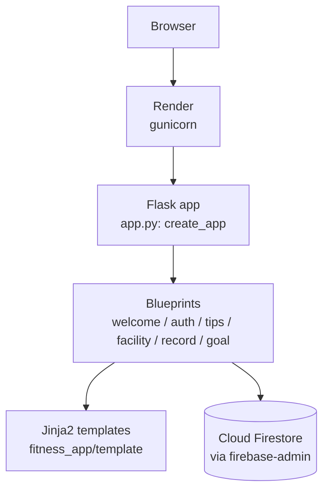

# Architecture

## Overview



## Design notes

| Item | Choice | Reason |
|:--|:--|:--|
| Web framework | Flask (application factory) | Lightweight and quick to build a Python web app with |
| Structure | One blueprint per feature | Each feature's routes stay separate and easy to extend |
| Database | Cloud Firestore (firebase-admin) | I was already familiar with Firebase, so I could build the data layer quickly |
| Config | Environment variables (`SECRET_KEY`, `FIREBASE_CREDENTIALS`) | Keeps secrets out of the repository; values are set in the hosting dashboard |
| Server | gunicorn | A widely used production WSGI server for Flask (Flask's built-in server is for development only) |
| Hosting | Render | Easy to deploy a Flask app directly from a GitHub repository |

## Directory layout

```
fitness_app/
├── app.py          # create_app(): registers blueprints
├── config.py       # reads SECRET_KEY from the environment
├── extensions.py   # initialises the Firebase / Firestore client
├── seed.py         # loads sample tips into Firestore
├── blueprints/     # welcome, auth, tips, facility, record, goal
└── template/       # HTML templates per feature
```

## Future work

- Add automated tests (pytest) with a mocked Firestore client
- Pin dependency versions in `requirements.txt`